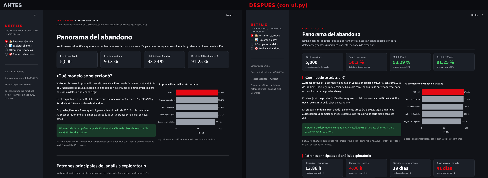
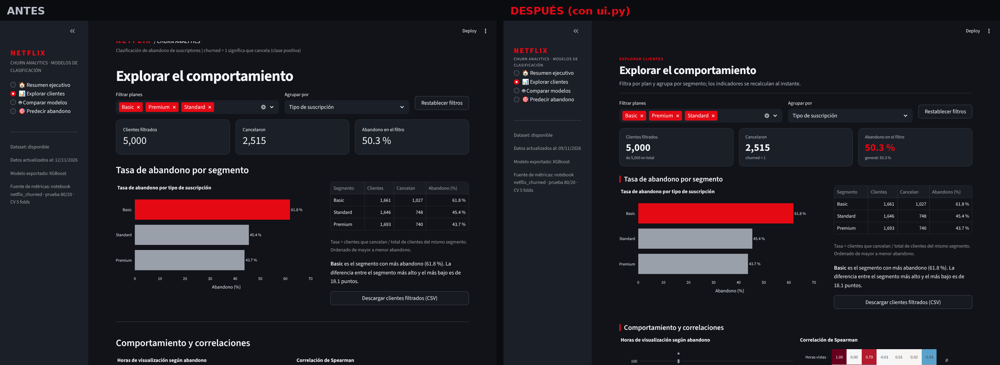
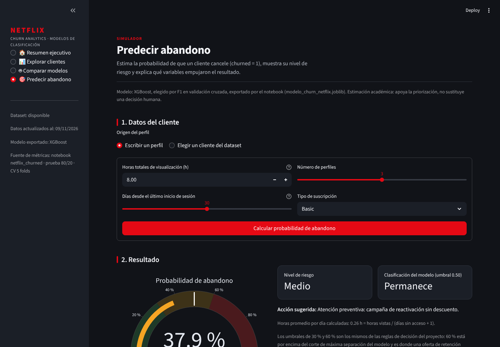

# Avance de la semana · Juan Carlos Muñoz Flores (A01712391)

**Compromiso registrado:** Componentes HTML y CSS en Streamlit. **Estado: cumplido.**

**Archivos:** `ui.py` (nuevo) y `app.py` (actualizado para usarlo).
**Liga al archivo / commit:** https://github.com/RICK1130042/Netflix_clasificadores/blob/main/ui.py

## Evidencia (app funcionando)

## Qué construí
Un módulo `ui.py` con los componentes visuales del tablero: `encabezado_pagina`, `seccion`, `tarjeta_kpi` / `fila_kpis`, `tarjeta_lista`, `nota`, `pie` y `marca`, más una sola hoja de estilos.

## Cómo funciona
- `aplicar_estilos()` inyecta una vez, con `st.markdown(..., unsafe_allow_html=True)`, un bloque `<style>` con variables CSS (`--rojo`, `--tarjeta`, `--borde`…) generadas desde el diccionario `COLORES` de Python. Cambiar un color ahí lo cambia en las cuatro páginas.
- Cada componente arma un fragmento de HTML con clases propias (`.ui-kpi`, `.ui-seccion`…) y lo dibuja en el contenedor que se le pase (la página, una columna o la barra lateral).
- `fila_kpis` crea `st.columns(n)` y pone una tarjeta en cada columna. El parámetro `tono` (`normal`, `alerta`, `ok`, `aviso`) decide el color del valor: por ejemplo, F1 y Recall salen en verde porque superan la meta de 90 %, y la tasa de abandono sale en rojo.
- Todo el texto que viene de los datos pasa por `html.escape`, para que un valor con `<` o comillas no rompa el HTML.
- En `app.py` se quitó el CSS suelto y se cambiaron `st.title`, `st.subheader` y los `st.metric` por estos componentes.

## Cómo lo comprobé
Pruebas con `streamlit.testing.AppTest`: las 4 páginas cargan sin excepciones, cada una tiene encabezado y pie, y el filtro "solo Basic" sigue dando 1,661 clientes y 61.8 % de abandono, igual que antes del cambio.
