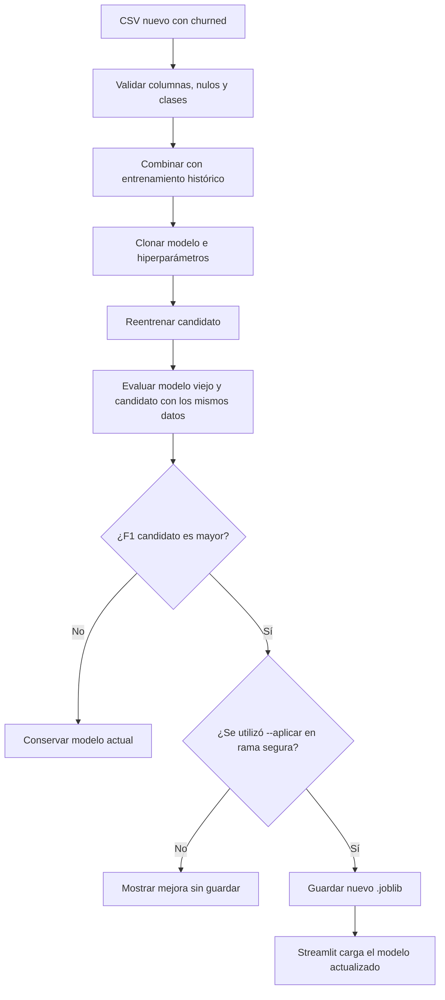

# Semanas 15 y 16 — Enrique | Netflix Customer Churn

## 1. Prediction (Predicción)

**Objetivo:** predecir si un cliente abandonará Netflix mediante un modelo de clasificación.

- **Entrada:** datos del cliente (`watch_hours`, `last_login_days`, `avg_watch_time_per_day`, `number_of_profiles`, `subscription_type`).
- **Procesamiento:** convertir el plan de suscripción a columnas numéricas con *One-Hot Encoding*, igual que durante el entrenamiento.
- **Modelo:** cargar `modelo_churn_netflix.joblib` y ejecutar `predict()` o `predict_proba()`.
- **Salida:** `churned = 0` si permanece y `churned = 1` si abandona; una probabilidad si se utiliza `predict_proba()`.

El modelo guardado es un **diccionario** que incluye al menos las claves `modelo` y `columnas`. La aplicación de Streamlit ya utiliza este formato.

### Ejemplo con datos del CSV del proyecto

Un registro del dataset incluye `watch_hours=14.73`, `last_login_days=29`, `avg_watch_time_per_day=0.49`, `number_of_profiles=1`, `subscription_type=Basic` y `churned=1` (resultado conocido). Para hacer una predicción, se proporcionan únicamente las variables de entrada; **nunca** `churned`.

El modelo devuelve su propia predicción, que puede coincidir o no con el resultado real. Aquí no se inventa una probabilidad.

> **Precaución:** las variables relacionadas con actividad solo son válidas si fueron medidas antes de conocer la cancelación. Si no, habría fuga de información.

## 2. Model Updating (Actualización del modelo)

**Objetivo:** cuando llegan datos etiquetados nuevos, entrenar una versión candidata usando los **mismos hiperparámetros** del modelo existente y reemplazarlo solo cuando sea mejor.

### Diagrama del ciclo de reentrenamiento



### ¿Por qué se utiliza F1?

F1 combina **precision** y **recall**, y es útil para valorar qué tan bien identificamos a quienes cancelan (`churned=1`). La métrica se calcula sobre el **mismo conjunto de evaluación** para ambos modelos; así, la comparación tiene sentido.

F1 se define como:

`F1 = 2 × (precision × recall) / (precision + recall)`

### ¿Cómo se eligen los hiperparámetros?

El script no vuelve a buscar parámetros: utiliza `clone(modelo_actual)`. Así se conserva la configuración seleccionada por el equipo (`n_estimators`, `max_depth`, `learning_rate`, etc., según el algoritmo), pero se comienza un entrenamiento nuevo.

### Ejemplo práctico reproducible

Desde la raíz de `Netflix_clasificadores`:

```bash
python src/reentrenar.py --nuevo data/nuevos_clientes_DEMO.csv
```

Este archivo de demostración contiene **datos sintéticos**, para comprobar que el flujo funciona. El script imprime los F1 calculados realmente y decide si hubo mejora. No modifica el `.joblib`.

Cuando exista un CSV **auténtico**, con `customer_id`, columnas predictoras y `churned` ya conocido:

```bash
python src/reentrenar.py --nuevo data/nuevos_clientes.csv
python src/reentrenar.py --nuevo data/nuevos_clientes.csv --aplicar
```

El segundo comando solo sustituye el archivo si **F1_nuevo > F1_anterior** y si no estás en `main`/`master`. Si la métrica es igual o peor, conserva el modelo actual.

### Nota sobre el conjunto de evaluación

Para reproducir la evaluación original del proyecto, el script usa **20 % del CSV original** (`random_state=42`, `stratify=churned`). El nuevo CSV no puede contener `customer_id` de ese 20 %. Esta es una demostración académica. En un sistema real, conviene reservar un conjunto de validación independiente y evitar reutilizar el conjunto final de prueba en múltiples decisiones de actualización.

## 3. Preguntas posibles del profesor

**¿Qué es el reentrenamiento?** Volver a ajustar el modelo con datos etiquetados adicionales para captar patrones nuevos.

**¿Por qué no se sustituye siempre el modelo?** Porque los datos nuevos no garantizan un mejor resultado. Conservamos el modelo anterior si el F1 es igual o inferior.

**¿Qué son los hiperparámetros?** Opciones configuradas antes de entrenar; por ejemplo, cantidad de árboles, profundidad o tasa de aprendizaje. Se conservan gracias a `clone()`.

**¿Cuál es la diferencia entre `predict` y `predict_proba`?** `predict` entrega la clase 0/1; `predict_proba` devuelve probabilidades estimadas para cada clase.

**¿Qué evita la fuga de información?** Separar antes el conjunto de evaluación y prohibir que sus `customer_id` entren al reentrenamiento. También es importante que las variables precedan temporalmente a `churned`.

**¿Qué pasa si el nuevo CSV no tiene `churned`?** Sirve para predecir, pero no para reentrenar de manera supervisada. Necesitamos conocer las respuestas reales.

**¿Qué ocurre con valores nulos o columnas faltantes?** El script detiene el proceso e informa el problema. No actualiza el modelo.

**¿Por qué `.joblib` y no `.pkl`?** Ambos permiten serializar modelos de Python; el repositorio ya utiliza `.joblib`, por lo que respetamos su formato para no romper Streamlit.

**¿Por qué no se cambia `main`?** Porque desarrollamos y probamos en `feature/enrique-semanas-15-16`; los cambios llegan a `main` únicamente si el equipo hace un merge.

**¿Qué limitación tiene la evaluación?** Comparar muchas veces contra los mismos registros termina sesgando las decisiones; para producción se necesita monitorización, datos actuales y una evaluación independiente.
